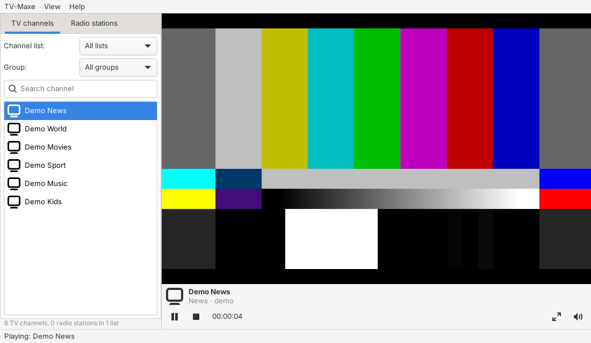

<div align="center">


# TV-Maxe

**Internet TV and radio player for Linux**

A from-scratch Rust rebuild of the classic TV-Maxe, with GTK 4 and libmpv.

[](https://github.com/condor2/tv-maxe-rs/actions/workflows/ci.yml)
[](LICENSE)




</div>

TV-Maxe keeps the window layout of the original application by Ovidiu Nițan and opens its channel
lists, but it is a complete rewrite and contains no code from the original project.

> [!NOTE]
> TV-Maxe ships without channel lists. Only add lists you have the right to use.

## Contents

- [Features](#features)
- [Installation](#installation)
- [Usage](#usage)
- [Favourites and zapping](#favourites-and-zapping)
- [Audio tracks](#audio-tracks)
- [Recording](#recording)
- [Sleep timer](#sleep-timer)
- [Supported list formats](#supported-list-formats)
- [Language](#language)
- [Data and settings](#data-and-settings)
- [KDE Plasma](#kde-plasma)
- [Development](#development)
- [Troubleshooting](#troubleshooting)
- [Roadmap](#roadmap)
- [License](#license)

## Features

- **TV and radio tabs** with channel logos and a *Channel list* picker for each subscription
- **Subscriptions** from the internet or from disk (TV-Maxe `.db`, M3U), which can be enabled,
  disabled and updated
- **Several sources per channel**: when one URL fails, the next is tried automatically; right-click a
  channel to pick a source yourself, and the info bar shows which one is playing (*source 2/3*)
- **My channels**: your own channels, added by hand, editable from the right-click menu and exportable
  as a TV-Maxe `.db`
- **TV guide (EPG)** from XMLTV (`.xml` / `.xml.gz`): what's on now under every channel, the current
  programme with progress and the next one under the video, and a day-by-day **TV guide** window
- **Large lists**: filter by group, diacritics-insensitive search, logos downloaded only for the
  visible rows (a 12,000-channel list loads in about two seconds)
- **Per-channel HTTP headers** (`http-referrer`, `http-user-agent`, `#EXTVLCOPT`) for servers that
  require them
- **Smooth playback on slow machines**: switches to mpv's fast scaling on software OpenGL or when too
  many frames are dropped
- **Favourites**: star the channels you watch most and show only them with one click
- **Keyboard zapping**: Page Up / Page Down, channel numbers typed on the keyboard, Backspace for the
  last channel watched, with the channel shown over the video
- **Audio track selection** for channels with several languages, with preferred languages that
  are picked automatically
- **Recording and scheduler**: record the channel you are watching with one click, or schedule
  recordings (once, daily or weekly) from the TV guide, the channel menu or the Recordings window
- **Sleep timer**: stops playback, quits, suspends or shuts down the computer after a while or at
  the end of the programme, with the volume fading out
- **Imports** the old TV-Maxe local list (`~/.tvmaxe/userlist.db`) on first start
- **English and Romanian** interface, following the system language
- Works on **Wayland and X11**

## Installation

### 1. Dependencies

You need Rust 1.92 or newer, GTK 4.14 or newer and libmpv.

| Distribution | Command |
|---|---|
| Arch Linux | `sudo pacman -S --needed base-devel rust gtk4 mpv` |
| Debian / Ubuntu 24.04+ | `sudo apt install build-essential pkg-config libgtk-4-dev libmpv-dev`, plus Rust from [rustup.rs](https://rustup.rs) |
| Fedora | `sudo dnf install gcc pkgconf-pkg-config gtk4-devel mpv-libs-devel rust cargo` |

### 2. Install

Run the script as your normal user, not as root. It asks for `sudo` only to copy the files.

```sh
git clone https://github.com/condor2/tv-maxe-rs.git
cd tv-maxe-rs
./install.sh
```

The script checks the dependencies, builds the release binary and installs:

| File | Path |
|---|---|
| Program | `/usr/local/bin/tvmaxe` |
| Menu entry | `/usr/local/share/applications/TvMaxe.desktop` |
| Icon | `/usr/local/share/icons/hicolor/scalable/apps/TvMaxe.svg` |

If a step fails, the previously installed version is restored. To install somewhere else, set the
prefix: `PREFIX=/usr ./install.sh`.

### Uninstall

```sh
./uninstall.sh            # removes the program; your channels and settings are kept
./uninstall.sh --purge    # also deletes ~/.local/share/tvmaxe
```

If you installed with a custom prefix, pass the same one: `PREFIX=/usr ./uninstall.sh`.

## Usage

Start **TV-Maxe** from the application menu (*Multimedia*), or from a terminal:

```sh
tvmaxe                         # normal start
tvmaxe ~/lists/channels.m3u    # add a subscription from a file
tvmaxe https://…/list.m3u      # add a subscription from a URL
```

Add your channel lists in **TV-Maxe → Subscriptions…**, then double-click a channel to play it.

Right-click a channel for more:

| Menu item | What it does |
|---|---|
| Play | Plays the channel from its first source |
| Add to / Remove from favourites | Stars the channel (★) or removes the star |
| Source → 1, 2, 3… | Plays a specific URL (shown for channels with several sources). If it fails, the next ones are tried, then the earlier ones; ▶ marks the source that is playing |
| Record now | Starts recording the channel (until you stop it) |
| Schedule recording… | Opens the schedule form for the channel |
| Edit channel… | Changes the name, type and URLs of a channel in *My channels* (one URL per line, in order of preference) |
| Delete channel | Removes a channel from *My channels* |

Channels that come from a subscription cannot be edited, because the next list update would
overwrite them; add your own version to *My channels* instead.

### Keyboard shortcuts

| Key | Action |
|---|---|
| Double-click, Enter | Play the selected channel |
| Ctrl+B | Subscriptions |
| Ctrl+R, F5 | Update the lists |
| Ctrl+N | Add a channel |
| Ctrl+, | Preferences |
| Ctrl+G | TV guide |
| Page Down / Page Up | Next / previous channel |
| 0–9 | Channel number (1 = first channel in the list) |
| Backspace | Last channel watched |
| A | Next audio track |
| Ctrl+D | Add the current channel to the favourites / remove it |
| Ctrl+Shift+R | Record the current channel / stop recording it |
| Ctrl+J | Recordings |
| Ctrl+T | Sleep timer |
| Ctrl+F | Search |
| F11, double-click on the video | Fullscreen (Esc leaves it) |
| F9 | Hide or show the channel list |
| Ctrl+Q | Quit |

### Preferences

**TV-Maxe → Preferences…** has hardware decoding, network buffer, connection timeout, video
quality (*Automatic*, *Best quality*, *Fast*), preferred audio languages, the User-Agent for lists
and streams, extra EPG
sources, the recordings folder, updating the lists at startup, logo downloads and playing the
last channel on startup. Changes apply immediately.

## Favourites and zapping

- Click **☆** under the video (Ctrl+D), or right-click a channel → **Add to favourites**. Favourite
  channels get a ★ in the list.
- Choose **★ Favourites** in the *Channel list* picker (or **View → Show favourites**) to see only
  them. The entry appears once you have at least one favourite, separately for TV and radio.
- Favourites are kept by channel URL, so they survive list updates and work across subscriptions.

Zapping works on the list **as it is shown** in the current tab: search, group filter and
favourites included, so with *★ Favourites* selected Page Up / Page Down go only through your
favourites.

| Key | What it does |
|---|---|
| Page Down / Page Up | Next / previous channel, wrapping around at the end of the list |
| 0–9 | Type a channel number; it switches after a short pause (*12* = the twelfth channel shown) |
| Backspace | Back to the channel you watched before |

The channel number and name appear over the video for a few seconds. The keys are ignored while
you type in the search field.

## Audio tracks

When a channel has more than one audio track, an **audio track** button (♪) appears under the video,
next to fullscreen. It lists the tracks with their language, codec and channels (*English (AAC,
5.1)*); press **A** to go to the next one.

To have your language chosen automatically, set **Preferences → Preferred audio languages** to a
list in order of preference, for example `ro, en`. Two- and three-letter codes both work (`ro`,
`ron`, `rum`).

## Recording

| How | What it does |
|---|---|
| **●** button (Ctrl+Shift+R) | Records the channel you are watching until you press it again. The title is the programme on air, when the TV guide knows it |
| Channel menu → **Record now** | The same, for any channel, without switching to it |
| TV guide → **●** next to a programme | Schedules that programme, 2 minutes early and 5 minutes late, since broadcasts rarely run exactly on time |
| Channel menu → **Schedule recording…** | Schedules a recording: date, start, end (an end before the start is the next day) and repeat (once, every day, every week) |
| **TV-Maxe → Recordings…** (Ctrl+J) | Lists running, scheduled and finished recordings: stop, edit or cancel them, play a finished one in TV-Maxe or show it in its folder |

While something is being recorded, the status bar shows a red **● REC**; click it to open the
Recordings window. Quitting TV-Maxe during a recording asks first, and keeps what was recorded.

How it works:

- Recordings are written to **`~/Videos/TV-Maxe`** (change it in *Preferences*), as
  `Channel 2026-10-14 20.30 - Title.ts`.
- The stream is saved **as it arrives, without re-encoding** (MPEG-TS), by a separate, hidden mpv
  instance. It does not depend on what you are watching, so you can watch one channel and record
  another, or record several at once. Each recording opens its own connection to the server: lists
  that allow a single connection per account cannot play and record at the same time.
- Like playback, a recording tries the channel's other sources when one fails. If the stream drops
  in the middle, it reconnects and continues in a new part (`… (2).ts`).
- **TV-Maxe must be running** for scheduled recordings to start. A recording whose time passed
  while TV-Maxe was closed is marked *Missed*; a repeating one moves on to its next occurrence.

## Sleep timer

**TV-Maxe → Sleep timer…** (Ctrl+T) sets what happens and when:

- **After:** a number of minutes (one click for 15, 30, 45, 60, 90 or 120), or the end of the programme
  on air when the TV guide knows it.
- **Then:** stop playback, quit TV-Maxe, suspend the computer or shut it down. Suspend and shut down
  go through logind and are offered only when the system allows them.

The countdown (**☾ 29:41**) stays in the status bar; click it to change or cancel the timer. The
volume fades out during the last 30 seconds. A running recording is never cut off: if one is in
progress when the time is up, TV-Maxe only stops playback and stays open.

## Supported list formats

The format is detected from the content, not from the file extension.

| Format | Details |
|---|---|
| TV-Maxe `.db` | SQLite with `info`, `tv_channels`, `radio_channels`; icons as base64 PNG (0.x) or blob (NG); `streamurls` as JSON |
| TV-Maxe text (old) | `\|tvchannels\|\|newchannel\|Name\|-\|url\|-\|logo…` |
| M3U / M3U8 | `tvg-id`, `tvg-logo`, `group-title`, `#EXTGRP`, `url-tvg` / `x-tvg-url`, `radio="true"`, `http-referrer`, `http-user-agent`, `#EXTVLCOPT` |

In M3U files, consecutive URL lines after the same `#EXTINF` become fallback URLs of one channel.

**TV guide:** sources come from the lists (`url-tvg` in M3U, `epgurl` in TV-Maxe) or from
Preferences. Channels are matched by `tvg-id`, then by name (ignoring diacritics and HD/FHD
suffixes). Only channels present in your lists and the days from yesterday to a week ahead are
kept; the guide refreshes every 12 hours.

## Language

The interface is in **English**, or in **Romanian** on a Romanian system. The language is picked
like for any Linux program, from `LANGUAGE`, then `LC_ALL`, `LC_MESSAGES` and `LANG`. To choose it
for one run:

```sh
LANGUAGE=ro tvmaxe    # Romanian
LANGUAGE=en tvmaxe    # English
```

Translations are compiled into the binary, so there are no extra files to install. Adding a
language means adding a catalog next to
[`catalog_ro.rs`](crates/tvmaxe-core/src/i18n/catalog_ro.rs).

## Data and settings

Everything is stored in one SQLite database, `~/.local/share/tvmaxe/tvmaxe.db`:

| Table | Contents |
|---|---|
| `subscriptions` | Subscriptions: name, URL, enabled, last update, last error |
| `channels` | Local copy of the channels, so TV-Maxe starts without internet too |
| `logos` | Downloaded logos; failures are remembered and not retried on every start |
| `epg_sources`, `epg_channels`, `epg_programmes` | The downloaded TV guide |
| `recordings` | Recordings: channel and URLs, start, end, repeat, status and the files written |
| `settings` | Preferences (`pref.*`), volume, window size, tab and last channel |

## KDE Plasma

TV-Maxe is a GTK 4 application, not Qt/Kirigami. It runs normally on Plasma (Wayland and X11), but
it looks like a GTK application. For a better fit:

- Install the Breeze theme for GTK (`breeze-gtk` on Arch, `breeze-gtk-theme` on Debian/Ubuntu) and
  select it in *System Settings → Application Style → Configure GNOME/GTK Application Style*.
- For the KDE file dialog, install `xdg-desktop-portal-kde` and set `GDK_DEBUG=portals`. Without it,
  GTK 4 uses its own file dialog outside Flatpak.

## Development

### Build and run

```sh
cargo build --release
./target/release/tvmaxe
cargo run -p tvmaxe-core --example inspect -- list.db    # print what a list contains
```

All application code is Rust. GTK 4 (interface) and libmpv/FFmpeg (video) are system libraries.
SQLite is compiled into the binary (`rusqlite` with `bundled`).

### Tests

```sh
cargo test --workspace                   # unit tests + translation coverage, no display needed
scripts/integration-tests.sh x11         # integration tests on Xvfb
scripts/integration-tests.sh wayland     # integration tests on headless Weston
```

The integration tests run the real application with libmpv and GTK on a virtual display with
software OpenGL. They need no internet: the video is generated by mpv (`lavfi`) or, for the
recording tests, by `ffmpeg` (H.264/AAC), and the HTTP server is local. Without ffmpeg the recording
tests are skipped (in CI they are mandatory).

| Test | What it checks |
|---|---|
| [`player.rs`](crates/tvmaxe/tests/player.rs) | mpv under a non-C locale; playback **and rendering** in GtkGLArea (a capture of the video area must show the colour bars); fallback URLs; failure when every URL fails; switching away from a dead URL (its late error must not fail the new channel); Referer / User-Agent headers; pause and stop; radio; choosing an audio track by preferred language and by hand |
| [`ui.rs`](crates/tvmaxe/tests/ui.rs) | Main window and menu; a subscription from a local M3U; playback with a fallback URL; choosing a source; editing a channel in *My channels*; the ● button, a scheduled recording, a missed daily one; the schedule form; the sleep timer (and that it never ends a recording); favourites, zapping by key, by number and back; every dialog opened and closed three times; F9; closing the window during playback |
| [`recorder.rs`](crates/tvmaxe/tests/recorder.rs) | The recording engine: a usable MPEG-TS file, fallback URLs, failure when every URL fails, reconnecting into a new part (no display needed) |
| [`translations.rs`](crates/tvmaxe/tests/translations.rs) | Every `tr("…")` has a Romanian translation, and the catalog has no unused entries |

Any GTK warning (for example *"A window is shown after it has been destroyed"*) fails the test.
Without a display, `cargo test` skips the integration tests; `TVMAXE_REQUIRE_DISPLAY=1` makes them
mandatory, and `TVMAXE_TEST_CAPTURE=/tmp/capture.png` saves the video capture.

**CI** ([`ci.yml`](.github/workflows/ci.yml), Ubuntu 24.04) runs `cargo fmt --check`,
`cargo clippy -D warnings`, `shellcheck`, `cargo test`, and the integration tests on both X11 and
Wayland. The video capture and the mpv log are kept as artifacts.

### Project layout

```text
crates/tvmaxe-core/          no UI, fully unit-tested
  src/formats/               list detection and parsers (TV-Maxe .db, TV-Maxe text, M3U), .db export
  src/epg.rs                 XMLTV parser (gzip, filtering, name matching)
  src/db.rs                  SQLite storage: subscriptions, channels, logos, guide, settings
  src/net.rs                 downloads of lists, logos and guides (worker threads)
  src/recording.rs           recordings: model, scheduling rules, file names
  src/i18n.rs, src/i18n/     tr / trn / fill and the Romanian catalog
crates/tvmaxe/               GTK 4 application
  src/main.rs                the binary: calls tvmaxe::run()
  src/lib.rs                 application, menu and style
  src/window.rs, window/     main window, playback, subscriptions, logos, guide, recording scheduler, sleep timer
  src/channel_list.rs        TV / Radio tab
  src/dialogs/               Subscriptions, Add channel, Preferences, TV guide, Recordings, Sleep timer, About
  src/settings.rs            preferences stored in SQLite
  src/sleep.rs               sleep timer: actions, volume fade, countdown text
  src/player/mod.rs          Player facade and Backend trait
  src/player/mpv/            libmpv backend rendering into a GtkGLArea; headless recorder
  tests/                     integration and translation tests
data/                        .desktop file and icon
install.sh, uninstall.sh     system-wide install / uninstall
scripts/integration-tests.sh integration tests on Xvfb or headless Weston
```

### Video backend

The interface talks to `Player` ([`player/mod.rs`](crates/tvmaxe/src/player/mod.rs)), not to mpv
directly. `Player` holds the channel logic: the URL list, switching to the next URL when one fails,
state and pause. A backend implements only the simple operations of the `Backend` trait:

| Method | Purpose |
|---|---|
| `widget()` | The widget that shows the picture |
| `load(url, http)` / `stop()` | Start / stop a URL |
| `set_paused`, `is_paused`, `set_volume`, `position` | Playback controls |
| `apply_settings` | Playback preferences (hwdec, buffer, timeout, User-Agent, quality) |
| events | `Connecting`, `Playing`, `Buffering(%)`, `Ended`, `Failed(message)` |

The only backend today is `mpv` (default Cargo feature). A new one, such as libVLC 4 once it is
stable, needs a `player/<name>/` module, a Cargo feature and a branch in `create_backend()`; the
rest of the application stays the same.

## Troubleshooting

| Problem | What to do |
|---|---|
| A channel does not play | Run `TVMAXE_MPV_LOG=/tmp/mpv.log tvmaxe` and check the full mpv log. Some servers need a specific User-Agent (*Preferences*). |
| Choppy video on an old computer | Set *Preferences → Video quality* to *Fast*. On software OpenGL this happens automatically. |
| TV-Maxe is missing from the menu | Log out and back in. If `/usr/local/share` is not in `XDG_DATA_DIRS`, reinstall with `PREFIX=/usr ./install.sh`. |
| Radio plays no sound | Check that an audio output (PipeWire or PulseAudio) is running. |

## Roadmap

- [x] Recording and scheduler
- [x] Sleep timer
- [x] Favourites, keyboard zapping, audio track selection
- [ ] AUR and Flatpak packages
- [ ] More interface languages

## License

TV-Maxe is free software, released under the
[GNU General Public License, version 3 or later](LICENSE) (`GPL-3.0-or-later`).

The original TV-Maxe was created by **Ovidiu Nițan**. This rewrite keeps the credit to the original
author but contains no code from the original project.
